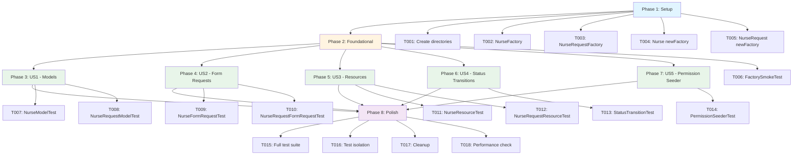
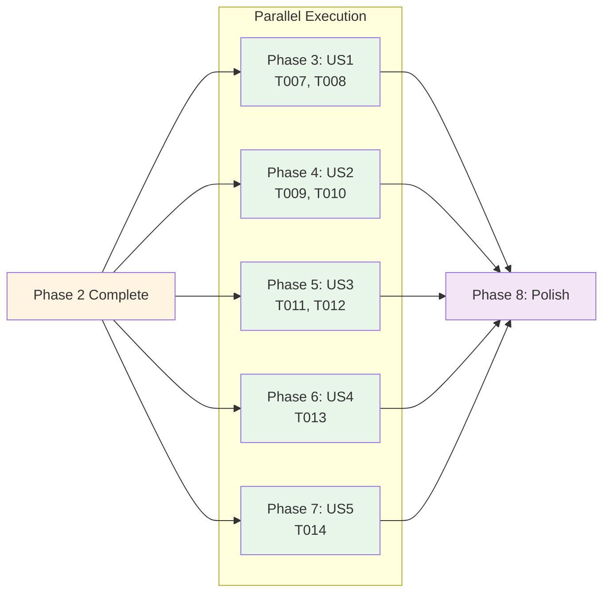

# خطة تنفيذ اختبارات الوحدة لوحدة RequestNurse

**التاريخ**: 2026-03-09  
**الفرع**: `001-requestnurse-unit-tests`  
**الوضع**: Architect Mode

---

## ملخص التنفيذ

إنشاء مجموعة شاملة من اختبارات الوحدة لوحدة RequestNurse تغطي:
- النماذج (Nurse, NurseRequest): العلاقات، النطاقات، الوصولات، التحويلات، الثوابت
- طلبات النماذج (NurseFormRequest, NurseRequestFormRequest): قواعد التحقق
- موارد API (NurseResource, NurseRequestResource): تحويلات البيانات
- منطق الأعمال (StatusTransitionTest): انتقالات الحالة وحساب المبلغ الإجمالي
- بذور الأذونات (RequestNursePermissionSeeder): إنشاء الأدوار والأذونات

---

## البنية التحتية الحالية

### الملفات الموجودة
✅ [`Modules/RequestNurse/Models/Nurse.php`](Modules/RequestNurse/Models/Nurse.php) - نموذج Nurse  
✅ [`Modules/RequestNurse/Models/NurseRequest.php`](Modules/RequestNurse/Models/NurseRequest.php) - نموذج NurseRequest  
✅ [`Modules/RequestNurse/Http/Requests/NurseFormRequest.php`](Modules/RequestNurse/Http/Requests/NurseFormRequest.php) - طلب نموذج Nurse  
✅ [`Modules/RequestNurse/Http/Requests/NurseRequestFormRequest.php`](Modules/RequestNurse/Http/Requests/NurseRequestFormRequest.php) - طلب نموذج NurseRequest  
✅ [`Modules/RequestNurse/Transformers/NurseResource.php`](Modules/RequestNurse/Transformers/NurseResource.php) - مورد API Nurse  
✅ [`Modules/RequestNurse/Transformers/NurseRequestResource.php`](Modules/RequestNurse/Transformers/NurseRequestResource.php) - مورد API NurseRequest  
✅ [`Modules/RequestNurse/Http/Controllers/Backend/NurseRequestsController.php`](Modules/RequestNurse/Http/Controllers/Backend/NurseRequestsController.php) - Controller  
✅ [`Modules/RequestNurse/database/seeders/RequestNursePermissionSeeder.php`](Modules/RequestNurse/database/seeders/RequestNursePermissionSeeder.php) - Seeder  
✅ [`phpunit.xml`](phpunit.xml) - تكوين PHPUnit مع SQLite in-memory  
✅ [`.gitignore`](.gitignore) - ملف التجاهل  

### المجلدات المطلوبة
📁 `Modules/RequestNurse/Tests/Unit/` - مجلد اختبارات الوحدة (يحتاج إنشاء)  
📁 `Modules/RequestNurse/database/factories/` - مجلد المصانع (يحتاج إنشاء)  

---

## خطة التنفيذ التفصيلية

### المرحلة 1: الإعداد (Setup)

#### T001: إنشاء بنية المجلدات
**الملف**: إنشاء مجلدات  
**المسار**: 
- `Modules/RequestNurse/Tests/Unit/`
- `Modules/RequestNurse/database/factories/`

**الإجراء**: إنشاء المجلدات المطلوبة

---

#### T002: إنشاء NurseFactory
**الملف**: `Modules/RequestNurse/database/factories/NurseFactory.php`  
**الوصف**: إنشاء مصنع للنموذج Nurse

**الكود المطلوب**:
```php
<?php

namespace Modules\RequestNurse\Database\Factories;

use App\Models\User;
use Illuminate\Database\Eloquent\Factories\Factory;
use Modules\RequestNurse\Models\Nurse;

class NurseFactory extends Factory
{
    protected $model = Nurse::class;

    public function definition()
    {
        return [
            'nurse_id' => User::factory(),
            'vendor_id' => User::factory(),
            'specialization' => $this->faker->randomElement(['Pediatric', 'Geriatric', 'General', 'Critical Care']),
            'experience' => $this->faker->randomElement(['1-2 years', '3-5 years', '5-10 years', '10+ years']),
            'about' => $this->faker->paragraph(),
            'availability_status' => $this->faker->randomElement(['available', 'busy', 'off_duty']),
            'service_area' => $this->faker->city(),
            'hourly_rate' => $this->faker->randomFloat(2, 10, 200),
            'status' => 1,
        ];
    }
}
```

---

#### T003: إنشاء NurseRequestFactory
**الملف**: `Modules/RequestNurse/database/factories/NurseRequestFactory.php`  
**الوصف**: إنشاء مصنع للنموذج NurseRequest

**الكود المطلوب**:
```php
<?php

namespace Modules\RequestNurse\Database\Factories;

use App\Models\User;
use Illuminate\Database\Eloquent\Factories\Factory;
use Modules\RequestNurse\Models\NurseRequest;

class NurseRequestFactory extends Factory
{
    protected $model = NurseRequest::class;

    public function definition()
    {
        return [
            'patient_id' => User::factory(),
            'nurse_id' => User::factory(),
            'service_description' => $this->faker->paragraph(),
            'request_date' => now(),
            'preferred_date' => $this->faker->dateTimeBetween('now', '+1 month'),
            'preferred_time' => $this->faker->time('H:i'),
            'duration_hours' => $this->faker->numberBetween(1, 8),
            'address_line_1' => $this->faker->streetAddress(),
            'address_line_2' => $this->faker->secondaryAddress(),
            'city' => $this->faker->city(),
            'state' => $this->faker->state(),
            'country' => $this->faker->country(),
            'postal_code' => $this->faker->postcode(),
            'latitude' => $this->faker->latitude(),
            'longitude' => $this->faker->longitude(),
            'contact_number' => $this->faker->phoneNumber(),
            'status' => NurseRequest::STATUS_PENDING,
            'payment_status' => false,
            'total_amount' => 0,
            'patient_notes' => $this->faker->paragraph(),
            'admin_notes' => $this->faker->paragraph(),
        ];
    }
}
```

---

#### T004: إضافة newFactory() إلى Nurse
**الملف**: `Modules/RequestNurse/Models/Nurse.php`  
**الوصف**: إضافة طريقة newFactory() لربط المصنع

**التعديل المطلوب**: إضافة الطريقة التالية في نهاية الفئة:
```php
protected static function newFactory()
{
    return \Modules\RequestNurse\Database\Factories\NurseFactory::new();
}
```

---

#### T005: إضافة newFactory() إلى NurseRequest
**الملف**: `Modules/RequestNurse/Models/NurseRequest.php`  
**الوصف**: إضافة طريقة newFactory() لربط المصنع

**التعديل المطلوب**: إضافة الطريقة التالية في نهاية الفئة:
```php
protected static function newFactory()
{
    return \Modules\RequestNurse\Database\Factories\NurseRequestFactory::new();
}
```

---

### المرحلة 2: التحقق الأساسي (Foundational)

#### T006: إنشاء FactorySmokeTest
**الملف**: `Modules/RequestNurse/Tests/Unit/FactorySmokeTest.php`  
**الوصف**: اختبار بسيط للتحقق من عمل المصانع

**الكود المطلوب**:
```php
<?php

namespace Modules\RequestNurse\Tests\Unit;

use Illuminate\Foundation\Testing\RefreshDatabase;
use Modules\RequestNurse\Models\Nurse;
use Modules\RequestNurse\Models\NurseRequest;
use Tests\TestCase;

class FactorySmokeTest extends TestCase
{
    use RefreshDatabase;

    public function test_nurse_factory_creates_record()
    {
        $nurse = Nurse::factory()->create();
        
        $this->assertDatabaseHas('nurses', [
            'id' => $nurse->id,
            'nurse_id' => $nurse->nurse_id,
        ]);
    }

    public function test_nurse_request_factory_creates_record()
    {
        $request = NurseRequest::factory()->create();
        
        $this->assertDatabaseHas('nurse_requests', [
            'id' => $request->id,
            'patient_id' => $request->patient_id,
        ]);
    }
}
```

---

### المرحلة 3: اختبارات النماذج (User Story 1 - Priority P1)

#### T007: إنشاء NurseModelTest
**الملف**: `Modules/RequestNurse/Tests/Unit/NurseModelTest.php`  
**الوصف**: اختبارات شاملة لنموذج Nurse

**الاختبارات المطلوبة**:
- `test_nurse_belongs_to_user()` - اختبار العلاقة مع User
- `test_nurse_belongs_to_vendor()` - اختبار العلاقة مع Vendor
- `test_nurse_vendor_is_nullable()` - اختبار أن vendor nullable
- `test_nurse_has_many_nurse_requests()` - اختبار العلاقة hasMany
- `test_full_name_accessor_returns_user_full_name()` - اختبار accessor full_name
- `test_full_name_accessor_returns_empty_when_no_user()` - اختبار حالة edge case
- `test_available_scope_filters_correctly()` - اختبار scope available
- `test_active_scope_filters_correctly()` - اختبار scope active
- `test_hourly_rate_cast_to_double()` - اختبار التحويل إلى double
- `test_status_cast_to_integer()` - اختبار التحويل إلى integer
- `test_fillable_fields()` - اختبار الحقول القابلة للملء

---

#### T008: إنشاء NurseRequestModelTest
**الملف**: `Modules/RequestNurse/Tests/Unit/NurseRequestModelTest.php`  
**الوصف**: اختبارات شاملة لنموذج NurseRequest

**الاختبارات المطلوبة**:
- `test_nurse_request_belongs_to_patient()` - اختبار العلاقة مع Patient
- `test_nurse_request_belongs_to_nurse()` - اختبار العلاقة مع Nurse
- `test_nurse_request_nurse_is_nullable()` - اختبار أن nurse nullable
- `test_nurse_request_belongs_to_nurse_profile()` - اختبار العلاقة مع NurseProfile
- `test_nurse_profile_returns_null_when_no_profile()` - اختبار حالة edge case
- `test_full_address_accessor_all_fields()` - اختبار accessor full_address
- `test_full_address_accessor_partial_fields()` - اختبار accessor مع حقول جزئية
- `test_full_address_accessor_all_null()` - اختبار accessor مع جميع الحقول null
- `test_status_badge_accessor_pending()` - اختبار accessor status_badge
- `test_status_badge_accessor_all_statuses()` - اختبار جميع الحالات
- `test_status_badge_accessor_unknown_status()` - اختبار حالة unknown
- `test_pending_scope()` - اختبار scope pending
- `test_confirmed_scope()` - اختبار scope confirmed
- `test_by_nurse_scope()` - اختبار scope byNurse
- `test_by_patient_scope()` - اختبار scope byPatient
- `test_by_status_scope()` - اختبار scope byStatus
- `test_scope_returns_empty_collection_when_no_matches()` - اختبار edge case
- `test_status_constants()` - اختبار الثوابت
- `test_statuses_array_contains_all_statuses()` - اختبار مصفوفة STATUSES
- `test_preferred_date_cast_to_carbon()` - اختبار التحويل إلى Carbon
- `test_payment_status_cast_to_boolean()` - اختبار التحويل إلى boolean
- `test_total_amount_cast_to_double()` - اختبار التحويل إلى double
- `test_duration_hours_cast_to_double()` - اختبار التحويل إلى double

---

### المرحلة 4: اختبارات طلبات النماذج (User Story 2 - Priority P2)

#### T009: إنشاء NurseFormRequestTest
**الملف**: `Modules/RequestNurse/Tests/Unit/NurseFormRequestTest.php`  
**الوصف**: اختبارات قواعد التحقق لـ NurseFormRequest

**الاختبارات المطلوبة**:
- `test_valid_data_passes_validation()` - اختبار البيانات الصحيحة
- `test_first_name_is_required()` - اختبار الحقل required
- `test_last_name_is_required()` - اختبار الحقل required
- `test_email_is_required()` - اختبار الحقل required
- `test_email_must_be_valid_format()` - اختبار تنسيق email
- `test_hourly_rate_is_required()` - اختبار الحقل required
- `test_hourly_rate_must_be_non_negative()` - اختبار min:0
- `test_hourly_rate_allows_zero()` - اختبار edge case
- `test_availability_status_must_be_valid_enum()` - اختبار in:available,busy,off_duty
- `test_availability_status_accepts_valid_values()` - اختبار القيم الصحيحة
- `test_about_max_length_2000()` - اختبار max:2000
- `test_optional_fields_can_be_null()` - اختبار الحقول الاختيارية

---

#### T010: إنشاء NurseRequestFormRequestTest
**الملف**: `Modules/RequestNurse/Tests/Unit/NurseRequestFormRequestTest.php`  
**الوصف**: اختبارات قواعد التحقق لـ NurseRequestFormRequest

**الاختبارات المطلوبة**:
- `test_valid_data_passes_validation()` - اختبار البيانات الصحيحة
- `test_patient_id_is_required()` - اختبار الحقل required
- `test_patient_id_must_exist_in_users()` - اختبار exists:users
- `test_service_description_is_required()` - اختبار الحقل required
- `test_service_description_max_1000()` - اختبار max:1000
- `test_preferred_date_is_required()` - اختبار الحقل required
- `test_preferred_date_must_be_today_or_future()` - اختبار after_or_equal:today
- `test_preferred_date_accepts_today()` - اختبار edge case
- `test_preferred_time_must_be_valid_format()` - اختبار date_format:H:i
- `test_preferred_time_accepts_valid_format()` - اختبار التنسيق الصحيح
- `test_duration_hours_is_required()` - اختبار الحقل required
- `test_duration_hours_min_1()` - اختبار min:1
- `test_duration_hours_max_24()` - اختبار max:24
- `test_address_line_1_is_required()` - اختبار الحقل required
- `test_city_is_required()` - اختبار الحقل required
- `test_contact_number_is_required()` - اختبار الحقل required
- `test_nurse_id_must_exist_if_provided()` - اختبار exists:users
- `test_optional_fields_can_be_null()` - اختبار الحقول الاختيارية

---

### المرحلة 5: اختبارات موارد API (User Story 3 - Priority P2)

#### T011: إنشاء NurseResourceTest
**الملف**: `Modules/RequestNurse/Tests/Unit/NurseResourceTest.php`  
**الوصف**: اختبارات تحويلات NurseResource

**الاختبارات المطلوبة**:
- `test_nurse_resource_contains_all_expected_keys()` - اختبار المفاتيح المتوقعة
- `test_nurse_resource_maps_user_data_correctly()` - اختبار تعيين بيانات User
- `test_nurse_resource_profile_image_is_null_when_no_media()` - اختبار حالة بدون صورة
- `test_nurse_resource_maps_nurse_fields_correctly()` - اختبار تعيين حقول Nurse

---

#### T012: إنشاء NurseRequestResourceTest
**الملف**: `Modules/RequestNurse/Tests/Unit/NurseRequestResourceTest.php`  
**الوصف**: اختبارات تحويلات NurseRequestResource

**الاختبارات المطلوبة**:
- `test_nurse_request_resource_contains_all_expected_keys()` - اختبار المفاتيح المتوقعة
- `test_patient_nested_object_structure()` - اختبار بنية الكائن المضمن patient
- `test_nurse_nested_object_structure()` - اختبار بنية الكائن المضمن nurse
- `test_nurse_is_null_when_unassigned()` - اختبار حالة بدون nurse
- `test_address_nested_object_structure()` - اختبار بنية الكائن المضمن address
- `test_address_full_address_excludes_null_parts()` - اختبار full_address
- `test_preferred_date_formatted_as_y_m_d()` - اختبار تنسيق التاريخ
- `test_payment_status_is_boolean()` - اختبار نوع payment_status

---

### المرحلة 6: اختبارات منطق الأعمال (User Story 4 - Priority P3)

#### T013: إنشاء StatusTransitionTest
**الملف**: `Modules/RequestNurse/Tests/Unit/StatusTransitionTest.php`  
**الوصف**: اختبارات انتقالات الحالة وحساب المبلغ

**الاختبارات المطلوبة**:
- `test_pending_to_confirmed_is_valid()` - اختبار الانتقال الصحيح
- `test_pending_to_cancelled_is_valid()` - اختبار الانتقال الصحيح
- `test_pending_to_in_progress_is_invalid()` - اختبار الانتقال غير الصحيح
- `test_pending_to_completed_is_invalid()` - اختبار الانتقال غير الصحيح
- `test_confirmed_to_in_progress_is_valid()` - اختبار الانتقال الصحيح
- `test_confirmed_to_cancelled_is_valid()` - اختبار الانتقال الصحيح
- `test_in_progress_to_completed_is_valid()` - اختبار الانتقال الصحيح
- `test_in_progress_to_cancelled_is_valid()` - اختبار الانتقال الصحيح
- `test_completed_is_terminal_state()` - اختبار الحالة النهائية
- `test_cancelled_is_terminal_state()` - اختبار الحالة النهائية
- `test_cancellation_records_cancelled_by_and_reason()` - اختبار تسجيل الإلغاء
- `test_same_status_transition_is_invalid()` - اختبار edge case
- `test_assign_nurse_calculates_total_amount()` - اختبار حساب المبلغ
- `test_assign_nurse_with_zero_hourly_rate()` - اختبار edge case
- `test_assign_nurse_sets_status_to_confirmed()` - اختبار تغيير الحالة
- `test_store_without_nurse_defaults_total_to_zero()` - اختبار القيمة الافتراضية

---

### المرحلة 7: اختبارات بذور الأذونات (User Story 5 - Priority P3)

#### T014: إنشاء PermissionSeederTest
**الملف**: `Modules/RequestNurse/Tests/Unit/PermissionSeederTest.php`  
**الوصف**: اختبارات RequestNursePermissionSeeder

**الاختبارات المطلوبة**:
- `test_seeder_creates_nurse_role()` - اختبار إنشاء دور nurse
- `test_seeder_creates_all_request_nurse_permissions()` - اختبار أذونات طلبات الممرضة
- `test_seeder_creates_all_nurses_management_permissions()` - اختبار أذونات إدارة الممرضات
- `test_admin_role_has_all_permissions()` - اختبار أذونات admin
- `test_demo_admin_role_has_all_permissions()` - اختبار أذونات demo_admin
- `test_nurse_role_has_only_view_permission()` - اختبار أذونات nurse
- `test_seeder_is_idempotent()` - اختبار idempotency

---

### المرحلة 8: التحسين والتحقق النهائي (Polish)

#### T015: تشغيل مجموعة الاختبارات الكاملة
**الوصف**: تشغيل `php artisan test --filter=RequestNurse` والتحقق من نجاح جميع الاختبارات

---

#### T016: التحقق من عزل الاختبارات
**الوصف**: تشغيل الاختبارات بترتيب عكسي أو بشكل فردي للتحقق من عدم وجود حالة مشتركة

---

#### T017: إزالة FactorySmokeTest
**الوصف**: حذف `Modules/RequestNurse/Tests/Unit/FactorySmokeTest.php` إذا تم تغطية تأكيداته في اختبارات قصص المستخدم

---

#### T018: التحقق من وقت التنفيذ
**الوصف**: التحقق من أن وقت تنفيذ مجموعة الاختبارات أقل من 30 ثانية

---

## مخطط التبعيات والتنفيذ



---

## استراتيجية التنفيذ الموازي

بعد إكمال المرحلة 2، يمكن تنفيذ المراحل 3-7 بالتوازي لأنها مستقلة:



---

## معايير النجاح

### معايير القبول (Acceptance Criteria)

1. ✅ جميع الاختبارات تنجح عند التشغيل: `php artisan test --filter=RequestNurse`
2. ✅ تغطية 100% لعلاقات النماذج، النطاقات، والوصولات
3. ✅ تغطية جميع قواعد التحقق مع حالة إيجابية وسلبية لكل قاعدة
4. ✅ تغطية جميع تحويلات موارد API
5. ✅ التحقق من جميع انتقالات الحالة الصحيحة وغير الصحيحة
6. ✅ وقت التنفيذ أقل من 30 ثانية
7. ✅ الاختبارات تعمل بشكل مستقل بدون تأثير متبادل

### معايير الجودة (Quality Criteria)

- ✅ جميع اختبارات الوحدة تستخدم `RefreshDatabase`
- ✅ جميع الاختبارات تستخدم المصانع لإنشاء بيانات الاختبار
- ✅ جميع الاختبارات تتبع اصطلاحات التسمية Laravel
- ✅ الكود منسق باستخدام Laravel Pint
- ✅ التعليقات واضحة ومفهومة
- ✅ لا توجد تكرار في الكود (DRY principle)

---

## الأدوات والتبعيات

### الأدوات المطلوبة
- PHPUnit ^10.1
- Laravel Testing Framework
- SQLite in-memory database
- Faker ^1.9.1
- Mockery ^1.4.4

### الأوامر المفيدة

```bash
# تشغيل جميع اختبارات RequestNurse
php artisan test --filter=RequestNurse

# تشغيل فئة اختبار محددة
php artisan test --filter=NurseModelTest
php artisan test --filter=NurseRequestModelTest
php artisan test --filter=NurseFormRequestTest
php artisan test --filter=NurseRequestFormRequestTest
php artisan test --filter=NurseResourceTest
php artisan test --filter=NurseRequestResourceTest
php artisan test --filter=StatusTransitionTest
php artisan test --filter=PermissionSeederTest

# تشغيل اختبار محدد
php artisan test --filter test_nurse_belongs_to_user

# تشغيل مع تغطية الكود
php artisan test --coverage

# تنسيق الكود
./vendor/bin/pint
```

---

## ملاحظات هامة

### نمط التسجيل في المصانع
- استخدم `User::factory()` لإنشاء مستخدمين مرتبطين
- استخدم `$this->faker->randomElement()` للحقول التي تحتوي على قيم محددة
- استخدم `$this->faker->randomFloat()` للأرقام العشرية

### نمط اختبار العلاقات
- استخدم `load()` لتحميل العلاقات قبل الاختبار
- استخدم `assertDatabaseHas()` للتحقق من وجود السجلات
- استخدم `assertCount()` للتحقق من عدد السجلات

### نمط اختبار النطاقات (Scopes)
- أنشئ سجلات متعددة مع قيم مختلفة
- طبق النطاق وتحقق من النتائج
- تحقق من أن النطاق يرجع المجموعة الصحيحة

### نمط اختبار الوصولات (Accessors)
- أنشئ نموذجاً مع البيانات المطلوبة
- استدعِ الـ accessor وتحقق من القيمة
- اختبر edge cases (قيم null، قيم فارغة)

### نمط اختبار التحويلات (Casts)
- اضبط القيمة كسلسلة نصية
- استرجع القيمة وتحقق من النوع الصحيح
- استخدم `is_float()`, `is_int()`, `is_bool()`

### نمط اختبار الموارد (Resources)
- أنشئ نموذجاً مع العلاقات المطلوبة
- مرر النموذج عبر المورد
- تحقق من المفاتيح والقيم في الناتج

### نمط اختبار انتقالات الحالة
- أنشئ طلباً بحالة محددة
- حاول تغيير الحالة
- تحقق من النجاح أو الفشل المتوقع
- تحقق من البيانات المحفوظة

---

## التحقق النهائي

قبل اعتبار التنفيذ مكتملاً، تأكد من:

1. ✅ جميع الملفات تم إنشاؤها في المسارات الصحيحة
2. ✅ جميع الاختبارات تنجح عند التشغيل
3. ✅ الكود منسق باستخدام Laravel Pint
4. ✅ لا توجد أخطاء PHP أو Lint
5. ✅ وقت التنفيذ أقل من 30 ثانية
6. ✅ الاختبارات مستقلة وعازلة
7. ✅ التغطية شاملة لجميع المتطلبات

---

## المراجع

- [`specs/001-requestnurse-unit-tests/spec.md`](specs/001-requestnurse-unit-tests/spec.md) - مواصفات الميزة
- [`specs/001-requestnurse-unit-tests/plan.md`](specs/001-requestnurse-unit-tests/plan.md) - خطة التنفيذ الأصلية
- [`specs/001-requestnurse-unit-tests/tasks.md`](specs/001-requestnurse-unit-tests/tasks.md) - قائمة المهام
- [`specs/001-requestnurse-unit-tests/data-model.md`](specs/001-requestnurse-unit-tests/data-model.md) - نموذج البيانات
- [`specs/001-requestnurse-unit-tests/research.md`](specs/001-requestnurse-unit-tests/research.md) - البحث والقرارات
- [`specs/001-requestnurse-unit-tests/quickstart.md`](specs/001-requestnurse-unit-tests/quickstart.md) - دليل البدء السريع
